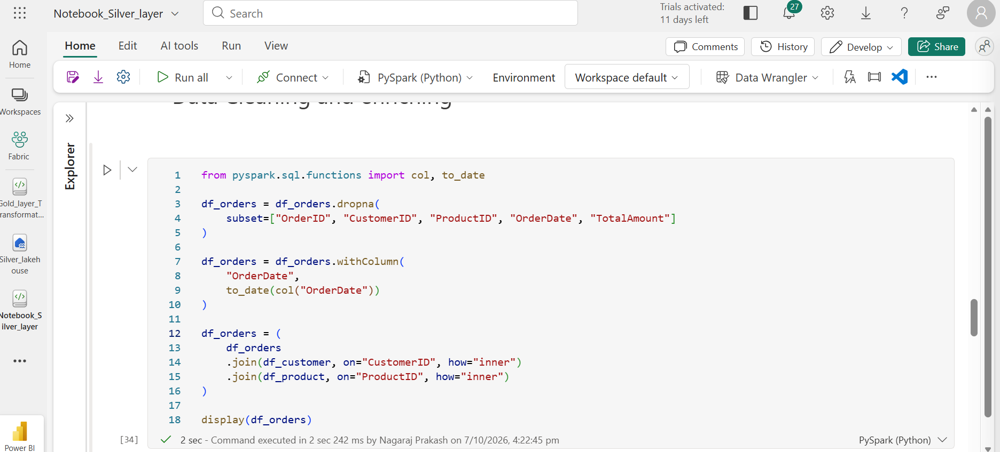

# Microsoft Fabric Medallion Architecture – ShoppingMart Data Engineering Project

## 📌 Project Overview

This project demonstrates an end-to-end data engineering solution using **Microsoft Fabric Medallion Architecture**. The project processes ShoppingMart data through Bronze, Silver, and Gold layers and prepares the transformed data for Power BI reporting.

The goal is to build a scalable data pipeline that ingests raw data, cleans and transforms it using PySpark, generates analytical datasets, and supports business reporting.

## 🎯 Project Objectives

* Build an end-to-end data engineering pipeline using Microsoft Fabric.
* Implement the Bronze, Silver, and Gold architecture.
* Automate data ingestion using Fabric Data Factory pipelines.
* Clean and transform data using PySpark notebooks.
* Store processed data in Lakehouse tables.
* Create aggregated datasets for analytical reporting.
* Prepare Gold-layer data for Power BI dashboards.
* Document the project and implementation in GitHub.

## 🏗️ Project Architecture


The project follows the Medallion Architecture approach:

* **Bronze Layer:** Ingests and stores raw source data.
* **Silver Layer:** Cleans, validates, and transforms the data.
* **Gold Layer:** Creates aggregated datasets for analytics and reporting.
* **Power BI:** Uses the prepared data for business intelligence dashboards.

## 🛠️ Technologies Used

* Microsoft Fabric
* Fabric Data Factory
* Data Pipelines
* Microsoft Fabric Lakehouse
* PySpark
* Python
* Delta Tables
* Parquet Files
* SQL Analytics Endpoint
* Power BI
* GitHub

## 🥉 Bronze Layer – Raw Data Ingestion

The Bronze layer is responsible for ingesting raw ShoppingMart datasets into the Bronze Lakehouse.

### Implementation

The data ingestion pipeline uses a metadata-driven approach to process multiple datasets.

Pipeline activities include:

1. **Lookup Activity:** Reads dataset metadata from the `Datamart_Bronzelayer Lookup` configuration.
2. **ForEach Activity:** Iterates through the configured datasets.
3. **Delete Data Activity:** Removes existing data when required before loading.
4. **Copy Data Activity:** Copies the source data into the Bronze Lakehouse.

### Benefits

* Automates ingestion for multiple datasets.
* Reduces repetitive pipeline development.
* Supports reusable data-loading logic.
* Provides a raw-data layer for downstream transformations.

### Bronze Pipeline Screenshot


## 🥈 Silver Layer – Data Cleaning and Transformation

The Silver layer uses PySpark notebooks to clean, validate, and transform raw data from the Bronze Lakehouse.

### Datasets Processed

* Orders
* Reviews
* Social Media
* Web Logs

### Transformations Performed

**Orders**

* Handles missing values in required fields.
* Cleans and validates the dataset.
* Converts `OrderDate` into a date data type.
* Writes the transformed dataset to the Silver layer.

**Reviews**

* Processes review data.
* Applies data-cleaning transformations.
* Writes the cleaned data to the Silver layer.

**Social Media**

* Processes social media records.
* Prepares platform and sentiment information for analysis.
* Writes the transformed data to the Silver layer.

**Web Logs**

* Processes web activity records.
* Prepares user, page, and action information for analysis.
* Writes the cleaned data to the Silver layer.

### Silver Layer Notebook Screenshot



### Silver Layer Outputs

The Silver layer contains cleaned datasets, including:

* `customers.ordersdata`
* `ShoppingMart_Silver_Reviews/ShoppingMart_review`
* `ShoppingMart_Silver_Social_Media/ShoppingMart_social_media`
* `ShoppingMart_Silver_Web_Logs/ShoppingMart_web_logs`

*Note: These names reflect the project implementation. Confirm the exact table or path names in your Fabric workspace.*

## 🥇 Gold Layer – Business Aggregations

The Gold layer creates analytical datasets from the cleaned Silver-layer data using PySpark.

### Aggregations Performed

**1. Web Logs Analysis**

Groups web log data by:

* `user_id`
* `page`
* `action`

Calculates the record count for each combination to support analysis of user activity and page interactions.

**2. Social Media Analysis**

Groups social media data by:

* `platform`
* `sentiment`

Calculates the record count for each combination to support sentiment analysis across platforms.

**3. Reviews Analysis**

Groups review data by:

* `product_id`

Calculates the average rating for each product to support product-performance analysis.

### Gold Layer Outputs

* `ShoppingMart_Gold_Orders/ShoppingMart_customers_orderdata`
* `ShoppingMart_Gold_Reviews/ShoppingMart_review`
* `ShoppingMart_Gold_Social_Media/ShoppingMart_social_media`
* `ShoppingMart_Gold_Web_Logs/ShoppingMart_web_logs`

These datasets are intended for analytical queries and Power BI reporting.

## 📊 Power BI Reporting

The Gold layer is designed to support Power BI dashboards and business reporting.

Potential reporting areas include:

* Order and customer analysis.
* Product ratings and review analysis.
* Social media sentiment analysis.
* Website traffic and user activity analysis.

The Power BI reporting component is currently in progress.

## 🔄 End-to-End Data Flow

1. Ingest source data into the Bronze Lakehouse using a Data Factory pipeline.
2. Clean and transform the data using Silver-layer PySpark notebooks.
3. Generate aggregated analytical datasets using Gold-layer PySpark notebooks.
4. Store the processed outputs in the appropriate Lakehouse tables or paths.
5. Use the Gold-layer datasets for Power BI reporting.

**Overall flow:**

`Source Data → Bronze Lakehouse → Silver Lakehouse → Gold Lakehouse → Power BI`

## 📁 GitHub Repository Structure

```text
microsoft-fabric-medallion-architectures/
│
├── README.md
├── Medalion architure layout.png
├── Bronze layer pipeline.png
├── Notebook_Silver_layer.png
│
├── Gold_layer_Notebook/
├── Silver_layer_Notebook/
│
└── Bronze Pipeline Documentation/
```

## 💡 Key Learnings

* Designing a Medallion Architecture in Microsoft Fabric.
* Building metadata-driven data ingestion pipelines.
* Using Lookup, ForEach, Delete Data, and Copy Data activities.
* Implementing data cleaning and transformation with PySpark.
* Creating aggregated datasets for analytics.
* Organizing a data engineering project for GitHub documentation.
* Preparing curated data for Power BI reporting.

## 🚀 Future Enhancements

* Complete the Power BI dashboard.
* Add data-quality checks and validation rules.
* Implement pipeline failure handling and logging.
* Add incremental data-loading capabilities.
* Improve orchestration and monitoring.
* Document pipeline execution and testing results.

## 👨‍💻 Author

**Nagraj Baggon**

Power BI Developer | Microsoft Fabric | Data Engineering | PySpark | Power Automate
